# System Architecture Deep-Dive

This document details the underlying networking paradigms, operational boundaries, data synchronization flows, and low-level packet journey mappings governing the Home Infrastructure Lab ecosystem.

---

## 🥪 Ingress Architecture & The "Security Sandwich"

The lab architecture is structured as a zero-trust network bubble isolated from public routing tables. Network access follows a deterministic entry hierarchy:

```text
[ External Client ]
                │
         (Public Internet)
                │
                ▼
   [ Gateway: Port 51820/UDP ] ──► (Perimeter Boundary)
                │
                ▼
       [ WireGuard Ingress ]   ──► Decrypts & Terminates External Flow
                │
        (Isolated Subnet)
                │
                ├──► [ Local DNS Proxy: Blocky ] ──► Ad-blocking / DNS-over-HTTPS
                └──► [ Reverse Proxy: NPM ]      ──► Evaluates L7 Host Header (*.home)
                                │
                                ▼
                       [ Authelia ]              ──► Authentication + MFA Gatekeeper
                                │
                                ▼ (only if authenticated)
                       [ Target Backends ] (e.g., Navidrome Media Engine)
```

### Key Isolation Mechanics
1. **Perimeter Minimization**: The internet edge firewall drops all inbound protocol payloads except for authenticated WireGuard UDP packets hitting port `51820`. 
2. **Name Resolution Interception**: Once attached to the tunnel subnet, client traffic forces name evaluation through **Blocky**. This intercepts tracking configurations and proxies authenticated lookups upstream via strict DNS-over-HTTPS (DoH).
3. **Layer 7 Routing Consolidation**: Downstream application containers map local boundaries exclusively to internal Docker networks. Access to individual service dashboards is managed by **Nginx Proxy Manager**, which evaluates standard host header names (e.g., `music.home`) over internal layers without exposing raw backend application ports.

---

## 💾 Storage Boundaries & Core State Consistency

To enforce container statelessness and guarantee zero configuration drift, storage volumes follow strict boundary constraints:

* **Persistent Volatile State (`/DockerAppsData`)**: Read-Write (`rw`) mounts allocated strictly for local runtime database files, cryptographic user keys, and application log tracking layers.
* **Immutable Media State (`/songs`)**: Mounted strictly with **Read-Only (`:ro`) permissions** to the media subsystem. This ensures that application software exploits cannot corrupt, rewrite, or wipe raw backup storage banks on the physical filesystem arrays.

---

## 🗺️ Low-Level Packet Journey Mapping

```mermaid
sequenceDiagram
    autonumber
    actor iPhone as 📱 iPhone Client<br/>(10.8.0.2 over 5G)
    participant Router as 🌐 Edge Router<br/>(WAN :51820/udp)
    participant WG as 🔒 wg-easy<br/>(Host :51820/udp)
    participant Blocky as 🛡️ Blocky DNS<br/>(Host :53/udp)
    participant NPM as 🔀 Nginx Proxy Manager<br/>(Host :8080 / proxy net)
    participant Auth as 🪪 Authelia<br/>(proxy + internal net)
    participant Redis as 🗄️ Authelia Redis<br/>(authelia-internal :6379)
    participant Navi as 🎵 Navidrome<br/>(proxy net :4533)

    rect rgb(30, 41, 59)
        Note over iPhone,WG: Stage 1 & 2: Split-Tunnel Routing & WireGuard Decryption
        iPhone->>iPhone: Route check: 192.168.1.0/24 matches AllowedIPs
        iPhone->>Router: Encrypted UDP packet (Noise protocol)
        Router->>WG: Forward UDP :51820 → 192.168.1.100:51820
        WG-->>iPhone: Handshake verified & WG_DEFAULT_DNS injected
    end

    rect rgb(30, 27, 75)
        Note over iPhone,Blocky: Stage 3: Domain Resolution Hijacking (Layer 3/4)
        iPhone->>Blocky: DNS A-Record Query: "music.home" (:53/udp)
        Blocky-->>iPhone: Returns NAS IP: 192.168.1.100 (No port awareness)
    end

    rect rgb(6, 78, 59)
        Note over iPhone,NPM: Stage 4: Layer 7 Host Header Routing (Host → Docker Bridge)
        iPhone->>NPM: HTTP GET http://192.168.1.100:8080 (Host: music.home)
        NPM->>NPM: Match L7 Host header rule for music.home
    end

    rect rgb(59, 7, 100)
        Note over NPM,Redis: Stage 5: ForwardAuth Verification & Micro-Segmented Session Lookup
        NPM->>Auth: Sub-request: GET http://authelia:9091/api/authz/auth-request
        Auth->>Redis: Lookup session cookie over authelia-internal (:6379)
        Redis-->>Auth: Session valid + 2FA verified
        Auth-->>NPM: 200 OK (Headers: Remote-User, Remote-Groups)
    end

    rect rgb(69, 26, 3)
        Note over NPM,Navi: Stage 6: Internal Proxy Pass & Read-Only Media Delivery
        NPM->>Navi: Proxy request over "proxy" bridge → http://navidrome:4533
        Navi->>Navi: Read audio stream from :ro /songs volume
        Navi-->>NPM: Audio stream response
        NPM-->>iPhone: Encrypted response back through WireGuard tunnel
    end
```


```text
[ iOS Client (Mobile Data) ]
  │ (Targeting: https://music.home)
  ▼
[ Stage 1: Client Edge Partitioning ] ──► Matches AllowedIPs (192.168.1.0/24, 10.8.0.0/24)
  │
  ▼ (Encrypted UDP Transit: Port 51820)
[ Stage 2: Gateway Ingress & Decryption ] ──► Captured by wg-easy Container
  │
  ▼ (Internal Injected DNS Resolution Request)
[ Stage 3: Domain Resolution Hijacking ] ──► Captured by Blocky on Port 53/UDP
  │                                           ↳ Resolves music.home to internal IP
  ▼ (HTTP/HTTPS Payload Delivery)
[ Stage 4: Layer 7 Host Header Routing ] ──► Captured by Nginx Proxy Manager
  │
  ▼ (Forward Authentication Request)
[ Stage 5: Identity Verification ]       ──► Authelia validates session / forces login + MFA
  │                                           ↳ Returns 200 OK or redirects to auth.home
  ▼ (Only if Authelia approves)
[ Stage 6: Target Workload Execution ]   ──► Processed by Navidrome Engine
                                              ↳ Pulls media assets via Read-Only (:ro) volumes
```

### Stage 1: Client-Side Edge Partitioning (Split-Tunneling)
When a remote client initiates a network session over a cellular network interface, the local operating system kernel evaluates the destination address against active routing tables prior to packet serialization:
* **Public Internet Routing**: Requests targeting external public domains (e.g., `google.com`) bypass the virtual network interface completely. They route natively via the mobile carrier's gateway, conserving home broadband upstream bandwidth.
* **Cryptographic Tunnel Routing**: Requests targeting the home lab network space match the active WireGuard interface configuration parameters: `AllowedIPs = 192.168.1.0/24, 10.8.0.0/24`. The client kernel intercepts the payload, encrypts the network packets using high-performance Noise protocol keys, and encapsulates them into a secure UDP stream directed at the dynamic DNS perimeter endpoint (`<your-subdomain>tnas.duckdns.org:51820`).

### Stage 2: Gateway Ingress & Kernel Packet Handoff (`wg-easy`)
The encapsulated UDP packet arrives at the residential edge gateway firewall, initiating the hardware handoff sequence:
1. **Perimeter Layer Filtering**: The perimeter router discards all unauthenticated inbound traffic, exposing only a single forwarded port boundary: **`51820/udp`**. Inbound payloads hitting this port are forwarded directly to the physical NAS IP interface (`192.168.1.100`).
2. **Containerized Ingress Capture**: Inside the Docker runtime layer, the `wg-easy` container monitors the host's physical network interface card (NIC) binding via mapped daemon parameters: `51820:51820/udp`.
3. **Kernel-Level Packet Forwarding**: `wg-easy` validates the client's public key cryptographic signature and decrypts the underlying payload. The host Linux kernel, hardened via the runtime configuration flag `net.ipv4.ip_forward=1`, bridges the decoupled network spaces and safely switches the packet onto internal virtual Docker networks.

### Stage 3: Domain Resolution Hijacking (`blocky`)
To communicate with the target web application, the client browser must translate the plain-text string `music.home` into an evaluation-ready numerical address:
1. **Injected DNS Instruction**: During the initial WireGuard handshake, the ingress container forces an environment variable configuration directly into the client's network stack: `WG_DEFAULT_DNS=10.8.0.1`. This mandates that the client routes all domain name queries down the tunnel straight to the internal primary DNS resolver.
2. **Port 53 Binding**: Inside the application space, the **Blocky** proxy container maintains absolute authority over standard name resolution channels on the local network interface (`53:53/udp`, `53:53/tcp`).
3. **Custom Resolution Mapping**: The host operating system forwards the inbound query payload directly into the Blocky runtime engine. Blocky evaluates the host string (`music.home`), bypasses public upstream root authoritative servers, and returns the internal destination vector from its local mapping configuration: `music.home: 192.168.1.100`.
*Note: DNS layers operate exclusively at Layer 3/4 and are blind to application ports. Blocky resolves the text label down to the raw host IP (`192.168.1.100`). The client web browser then attaches the target port suffix (`:8080`) to the destination headers.*

### Stage 4: Layer 7 Host Header Routing (nginx-proxy-manager)With a resolved IP address in hand, the client sends an HTTP GET request targeting http://192.168.1.100:8080:
1. **Host OS Workspace Isolation**: Targeting port 8080 isolates the inbound infrastructure traffic from the host operating system's default admin portal (which occupies port 80/443 for TerraMaster OS system functions).
2. **Reverse Proxy Interception**: The payload hits the physical network interface card and is claimed by Nginx Proxy Manager, which listens on the host boundary via mapped port declarations: 8080:80.
**Layer 7 Inspection**: The proxy engine acts as the central traffic receptionist. It processes the payload, terminates the initial connection phase, and reads the application-layer incoming Host Header: music.home.
3. **Forward Authentication Trigger**: Instead of immediately proxying the request to the backend service, Nginx Proxy Manager initiates an internal sub-request to Authelia’s authorization endpoint (http://authelia:9091/api/authz/auth-request) to determine whether the requesting client is permitted to proceed.

### Stage 5: Identity Verification & Policy Enforcement (authelia)Nginx Proxy Manager suspends the original client request and waits for a decision from Authelia:
1. **Session Validation**: Authelia inspects the incoming request for a valid session cookie (authelia_session). If a valid, non-expired session exists and the required authentication level has already been satisfied, Authelia immediately returns HTTP 200 OK.
2. **Authentication Challenge**: If no valid session is present, Authelia returns HTTP 401 Unauthorized. Nginx Proxy Manager interprets this response and issues a 302 Redirect to the Authelia portal (https://auth.home), preserving the original destination via the rd (redirect) query parameter.
3. **Multi-Factor Enforcement**: Upon reaching the Authelia login portal, the user must complete primary authentication (username + Argon2id-verified password) followed by a second factor (TOTP or WebAuthn/Passkey), according to the access control policy defined for the target domain (two_factor).
4. **Session Establishment**: After successful authentication, Authelia issues a new encrypted session cookie, stores the session state in Redis, and redirects the browser back to the original requested URL (music.home).
5. **Authorization Decision**: On the subsequent request, Authelia validates the newly established session and returns 200 OK to Nginx Proxy Manager, allowing the original request to continue.

### Stage 6: Target Workload Execution (navidrome)Only after Authelia has explicitly authorized the request does the traffic proceed to the application layer:
1. **Internal Bridge Routing**: Nginx Proxy Manager maps the approved request for music.home to the downstream media container. The traffic is shifted across isolated virtual Docker bridge connections directly to the target workload container port: 4533.
2. **Workload Runtime Processing**: The payload enters the isolated Navidrome container runtime environment. Navidrome processes the request, queries its local SQLite database index file, and streams the requested media assets.
3. **Stateless Volumes Guard**: The engine reads raw audio files from storage spaces mounted strictly with Read-Only (:ro) volume flags (/Volume1/homes/<username>/songs:/music:ro). This architectural constraint ensures that even if an application-layer software exploit compromises the container runtime, the media assets on the storage array remain secure and immune to unauthorized file modifications or deletions.
