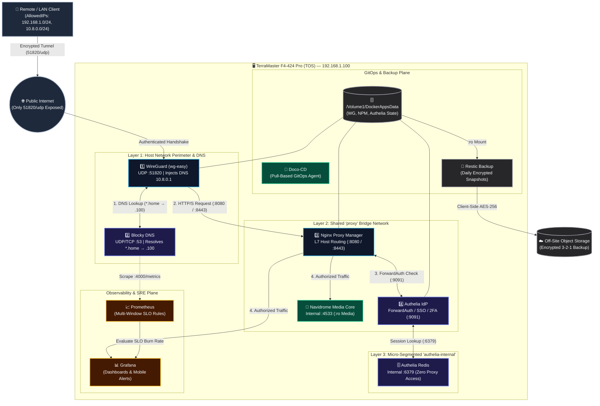

# Home Infrastructure Lab

[](https://github.com/karthikeyan-karuppiah/home-lab/actions/workflows/ci.yaml)
[](https://github.com/karthikeyan-karuppiah/home-lab/actions/workflows/release.yaml)
[](https://github.com/karthikeyan-karuppiah/home-lab/actions/workflows/pr-lint.yml)
[](https://renovatebot.com)

A declarative, GitOps-driven infrastructure monorepo for managing private network utilities, secure edge ingress, and media orchestration services deployed on an **Intel-powered TerraMaster F4-424 Pro** NAS cluster.

---

## 🏗️ System Architecture & GitOps Workflow

This repository implements an infrastructure-as-code (IaC) methodology to enforce an isolated **Split-Tunnel "Security Sandwich"** network topology.

* **Continuous Delivery**: Handled natively by **Doco-CD**, acting as an on-premise GitOps controller that continuously reconciles state updates from the `main` branch.
* **Network Hardening**: Exposes a single cryptographic edge ingress point via WireGuard. All underlying infrastructure portals, databases, and application UIs are completely insulated from the public web.

🔎 For a comprehensive packet journey mapping and security breakdown, see the [System Architecture Document](ARCHITECTURE.md).

---

### 🌐 Zero-Trust Network & Traffic Flow


---
### 📐 Architecture Decision Records (ADRs)

Key engineering trade-offs, empirical benchmarks, and evolutionary roadmaps are documented in [`docs/adr/`](docs/adr/README.md):

| ID | Decision | Architectural Rationale |
| :--- | :--- | :--- |
| **[ADR-001](docs/adr/001-docker-compose-and-doco-cd-over-kubernetes.md)** | Preserve TOS + Docker Compose + Doco-CD | Protects native TerraMaster RAID/storage stability while maintaining GitOps parity ahead of a planned **Talos Linux Kubernetes** migration. |
| **[ADR-002](docs/adr/002-sops-and-age-over-hashicorp-vault.md)** | Mozilla SOPS + `age` Secret Encryption | Enables zero-dependency encrypted secrets in Git with trivial bare-metal recovery and no circular bootstrap dependencies. |
| **[ADR-003](docs/adr/003-wireguard-only-zero-trust-perimeter.md)** | WireGuard-Only Zero-Trust Perimeter | Eliminates public HTTP surface and resolves iOS battery drain empirically observed with Tailscale's userspace daemon. |
| **[ADR-004](docs/adr/004-traefik-over-nginx-proxy-manager.md)** | Planned Migration: NPM $\rightarrow$ Traefik v3 | Roadmap to replace stateful UI "ClickOps" with declarative label routing, read-only `docker-socket-proxy`, and native HTTP metrics. |
| **[ADR-005](docs/adr/005-authelia-over-pocket-id.md)** | Authelia over Pocket ID | Provides reverse-proxy `ForwardAuth` for non-OIDC apps and declarative YAML policy-as-code alongside Passkey/TOTP 2FA. |

---

## 🚀 CI/CD Infrastructure & Automation Engineering

This monorepo utilizes an advanced, decoupled multi-stage execution pipeline built under strict zero-trust parameters to guarantee supply chain integrity before host cluster synchronization.

```text
  [ Pull Request Opened ]
             │
             ├──► (Pipeline 3) PR Title Linter  ──► Checks Semantic Compliance
             └──► (Pipeline 1) CI Engine        ──► Lint · Secrets · Compose Security · Image CVE/SBOM
                                       │
                              [ Merge to main ]
                                       │
                                       ▼
                         (Pipeline 1) CI Success Gate
                                       │
                        (Artifact Transit Upload)
                                       │
                                       ▼
                     (Pipeline 2) Release Management (CD)
                                       │
                                       ▼
                       Google Release Please Automation
```

### 📋 Automated Pipeline Directory

#### 1. Continuous Integration (`.github/workflows/ci.yml`)
Runs asynchronously on all target pushes and active pull requests to fail-fast on bad configuration patterns.
* **Secret Detection**: Gitleaks (full git history) and Trivy filesystem secret scanning to catch credential spills before merge.
* **Docker Compose Security**: compose-lint (OWASP / CIS Docker Benchmark) checks for privileged mode, Docker socket mounts, dangerous capabilities, unbound ports, missing resource limits, and unsafe credential handling.
* **Container Image Scanning**: Trivy scans images referenced in Compose files for CRITICAL/HIGH CVEs and generates CycloneDX SBOMs as workflow artifacts for supply-chain inventory.
* **Static Code Analysis**: Hadolint for Dockerfile best practices and Yamllint for infrastructure YAML specifications.
* **Compose Structure Validation**: `docker compose config` validates every Compose file for structural integrity before merge.
* **Cross-Boundary Data Transit**: Packages verified metadata into a secure short-retention GitHub build artifact on successful runs.

#### 2. Release Management (`.github/workflows/release.yml`)
An event-driven CD pipeline configured to trigger cleanly via `workflow_run` only when the primary CI pipeline ends successfully on the `main` branch.
* **State Verification**: Pulls and verifies the data integrity of the compiled metadata package generated upstream.
* **Semantic Engine**: Executes **Google Release Please** to parse semantic version patterns, compile automated changelogs, and cut production GitHub releases.

#### 3. PR Title Linter (`.github/workflows/pr-lint.yml`)
An isolated workflow evaluating branch metadata to enforce **Conventional Commits** (`feat:`, `fix:`, `chore:`). This prevents unparseable merge commits from polluting historical lines or crashing the downstream release generator.

---

## 🛠️ Service Catalog & Specifications

### 🔐 Edge Ingress & Routing

#### 1. WireGuard VPN (`/wg-easy`)
Provides high-performance, cryptographic remote entry paths into the lab network using a fast Split-Tunnel layout.
* **Dynamic Endpoint Routing**: Enforced via **DuckDNS** (`<your-subdomain>.duckdns.org`) to maintain connection states across dynamic ISP public IP rotations.
* **Image Registry**: `ghcr.io/wg-easy/wg-easy:v15`

#### 2. Nginx Proxy Manager (`/nginx-proxy-manager`)
Acts as the central reverse proxy and application layer router to handle hostname evaluation and decouple port configurations.
* **Capability**: Exposes clean internal proxy channels and manages upstream data flows.
* **Image Registry**: `jc21/nginx-proxy-manager:2.11`

### 🗺️ Network & Media Core

#### 3. Blocky (`/blocky`)
An ultra-lightweight local DNS proxy and network-wide sinkhole designed for local domain mapping and privacy hardening.
* **Upstream Delivery**: DNS-over-HTTPS (DoH) utilizing secure endpoints via Quad9 (`dns.quad9.net`) and Cloudflare.
* **Telemetry Protection**: Intercepts tracking and advertisement scripts at the name-resolution stage.
* **Image Registry**: `ghcr.io/0xerr0r/blocky:v0.35`

#### 4. Navidrome (`/navidrome`)
A streaming server subsystem compliant with Subsonic/Madsonic API specifications to host private media assets.
* **Capability**: Multithreaded library indexing, metadata extraction, and streaming abstraction.
* **Image Registry**: `deluan/navidrome:0.53`

---

## 📊 Network Topology & Port Matrix

The host operating system kernel rules enforce strict port boundaries. Only the WireGuard ingress port is mapped to your perimeter gateway.

| Subsystem Component       | Container Port | Host Port | Network Layer  | Boundary / Purpose                              |
| :------------------------ | :------------- | :-------- | :------------- | :---------------------------------------------- |
| **WireGuard Ingress**     | `51820/udp`    | `51820`   | Layer 4 (UDP)  | Mapped Gateway Cryptographic Entry              |
| **WireGuard UI**          | `51821/tcp`    | `51821`   | Layer 7 (HTTP) | Internal Peer Management Portal                 |
| **Blocky DNS Proxy**      | `53/udp`       | `53`      | Layer 4 (UDP)  | Internal Network Resolution Ingress             |
| **Blocky DNS Proxy**      | `53/tcp`       | `53`      | Layer 4 (TCP)  | Internal Fallback TCP Resolution                |
| **Blocky API & Metrics**  | `4000/tcp`     | `4000`    | Layer 7 (HTTP) | Health Check / Telemetry Endpoint               |
| **Nginx Proxy Manager**   | `80/tcp`       | `8080`    | Layer 7 (HTTP) | Local Hostname Routing Engine                   |
| **Nginx UI Dashboard**    | `81/tcp`       | `81`      | Layer 7 (HTTP) | Internal Proxy Rules Configuration              |
| **Nginx Secure Ingress**  | `443/tcp`      | `8443`    | Layer 7 (HTTPS)| Mapped for Local SSL Security Layers            |
| **Authelia**              | `9091/tcp`     | —         | Layer 7 (HTTP) | Internal only (reached via NPM)                 |
| **Navidrome Engine**      | `4533/tcp`     | `4533`    | Layer 7 (HTTP) | Dedicated Media Core Backend Ingress            |

---

## 📂 Storage Architecture & Volume Strategy

To maximize system security and preserve container statelessness, host mount spaces are cleanly partitioned between persistent application databases and absolute Read-Only data volumes:

```text
/Volume1/
├── DockerAppsData/
│   ├── Wireguard/           # Cryptographic tunnel peer profile states
│   ├── blocky/              # Core YAML local domain network maps
│   ├── nginx-proxy/         # Host routing tables and SQLite files
│   └── navidrome/data/      # User database metadata index configurations
└── homes/<username>/
    └── songs/               # Media Storage Vault (:ro Read-Only Mount)
```
